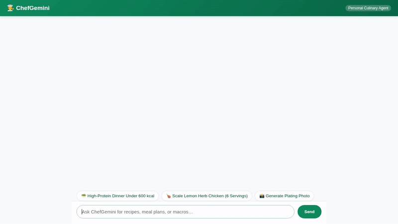

# ChefGemini - Personal Chef & Meal Planner

A conversational culinary assistant that helps home cooks plan balanced meals, discover global recipes, scale portions, calculate nutritional macros, and generate plating imagery.



---

## 🍳 What It Does

ChefGemini is built with the Google Agent Development Kit (ADK) using `gemini-3.8-flash` on Vertex AI. It combines real-world APIs, managed cloud databases, cloud storage, and reasoning sandboxes:

- **Custom Recipe Catalog (Firestore)**: Queries and fetches curated chef recipes stored in Google Cloud Firestore (`recipes` collection) by tag, prep time, or keyword.
- **Portion Scaling & Macro Calculator**: Adjusts recipe ingredients proportionally and computes comprehensive nutritional macros (calories, protein, carbs, fat) across customized serving sizes.
- **Global Recipe Search (TheMealDB)**: Fetches real-world international recipes, ingredients, and instructions from TheMealDB public culinary API.
- **Local Grocery & Market Discovery (Google Maps)**: Converts locations via the Geocoding API and searches nearby specialty food markets or grocery stores via the Google Places API (New).
- **Plating Photo Generation (Vertex AI & Cloud Storage)**: Generates appetizing dish presentation imagery using `gemini-3.1-flash-lite-image` on Vertex AI in the global region, emits the artifact directly into the ADK runtime, and uploads the image to a public Google Cloud Storage bucket (`gs://chefgemini-recipes-qwiklabs-gcp-04-610bbf0144b0`).
- **Python Sandbox Code Execution (Agent Engine Sandbox)**: Safely evaluates complex dietary or macro calculations using `AgentEngineSandboxCodeExecutor` hosted on Google Cloud Agent Platform.
- **Long-Term Memory Bank (Vertex AI)**: Persists user facts, dietary restrictions, and allergy profiles across distinct conversation sessions using `VertexAiMemoryBankService` and `PreloadMemoryTool`.
- **A2UI Interactive Cards**: Generates rich, structured A2UI card layouts rendered natively in the frontend.

*(Note: Real-time video cooking tutorial generation with omni models is planned and not yet implemented.)*

---

## 🏗️ Architecture & Cloud Services

- **LLM**: Gemini 3.8 Flash (`gemini-3.8-flash`) on Vertex AI.
- **Agent Framework**: Google Agent Development Kit (ADK) with A2A protocol support.
- **Database**: Google Cloud Firestore (Native mode).
- **Storage**: Google Cloud Storage (`chefgemini-recipes-*`).
- **Memory**: Vertex AI Memory Bank (Agent Platform).
- **Code Execution**: Vertex AI Agent Engine Sandbox Environment.
- **Image Generation**: Vertex AI `gemini-3.1-flash-lite-image`.
- **Frontend**: Lightweight FastAPI A2A proxy with custom dialog UI and native A2UI renderer.

---

## 🚀 Running Locally

### Prerequisites

- Python 3.11+
- `uv` package manager or `pip`
- Google Cloud CLI (`gcloud`) authenticated with Application Default Credentials:
  ```bash
  gcloud auth application-default login
  ```

### 1. Run the Agent via ADK Web

To start the agent with Vertex AI Memory Bank integration:

```bash
cd chef-gemini
uv sync
uv run adk web . --port 8080 --reload_agents --memory_service_uri=agentengine://<YOUR_AGENT_ENGINE_ID>
```

### 2. Run the Custom Web Frontend

To launch the branded chat UI and FastAPI proxy connecting to your deployed agent:

```bash
cd chef-gemini/frontend
python3 -m venv .venv
source .venv/bin/activate
pip install -r requirements.txt

export AGENT_ENGINE_RESOURCE_NAME="projects/<PROJECT_NUMBER>/locations/<LOCATION>/reasoningEngines/<ENGINE_ID>"
export AGENT_DIRECTORY="app"

python main.py
```
Open your browser to the local port indicated in the terminal (default port 8080).
